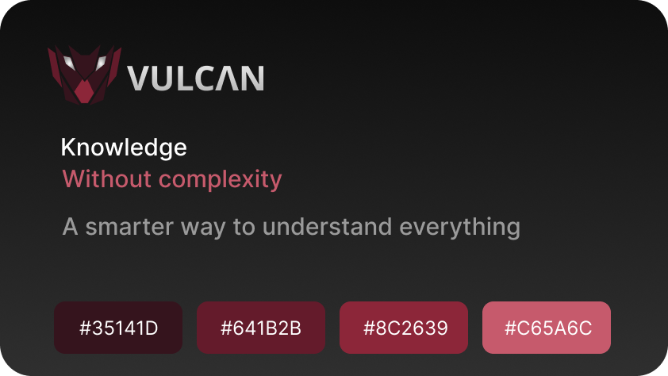
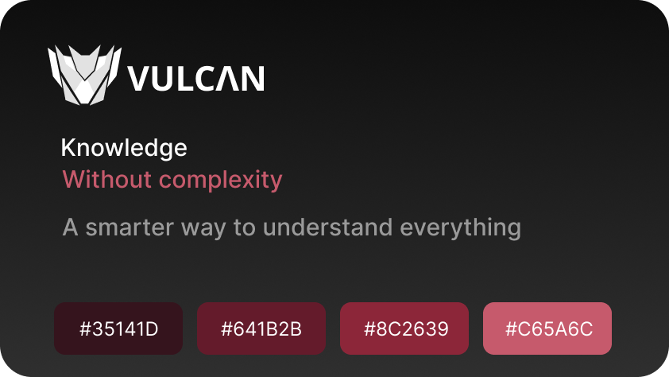
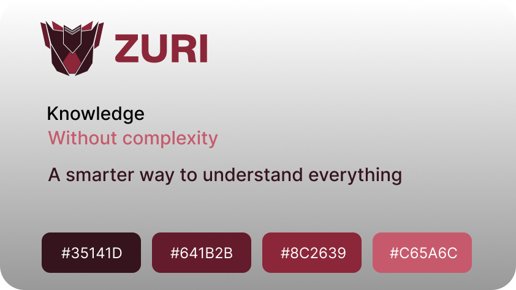

<h1>
 
 <span>Technical Documentation - Zuri</span>
</h1>

### Overview

React Widget for Local AI and Productivity

**Zuri - Intelligence By Your Side** is a **Chrome** extension built with `React` + `Manifest V3`. It is an AI Reading and Context Copilot—a `React` extension that allows you to select any text or code snippet on a web page and open a side panel with AI features: smart summary, explanation of complex snippets, extraction of key concepts, or explanatory translation.

Using built-in **AI APIs** from the browser itself to run offline and without API costs, or allowing the user to provide their own API Key. This project requires excellent mastery of React—browser DOM manipulation, content script injection, state management in the side panel, and asynchronous message communication in the **Chrome Extension**. Zuri transforms complex information into clear and concise answers.

It is an intelligence that learns to understand context and accompanies the user in their activities. Zuri was not developed to replace the user. It was developed to amplify what they are capable of doing.

An extension can only see what's inside the browser, so it works on any website.

## Characteres

Its 05 characteristics are:

- **Autonomous**: Analyzes situations and proposes paths;
- **Reliable**: Prioritizes useful and transparent answers;
- **Intelligent**: Understands contexts;
- **Partner**: Works alongside the user in any software, without trying to take their place;
- **Determined**: A strong identity and objective communication.

## Visual Identity

### 1. Colors

- Red: `#35141D` `#641B2B` `#8C2639` `#C65A6C`;
- White: `#F5F5F5`;
- Black: `#0E0E0E`;
- Gray: `#999999`;

### 2. Logo


</br>

</br>


## How to Use Zuri Plugin
 
1- Clone this repository
```powershell
git clone https://github.com/kauanvinicius9/Zuri.git
```

2- Enter in the project
```powershell
cd zuri
```

3- Install dependences
```powershell
npm install
```

4- Update files
```powershell
npm run build
```

5- Developer mode, "Load without compaction" choosing `dist` folder

```powershell
chrome://extensions
```

Then, the **activate** button on the landing page talks to the extension (via postMessage to the content script) and sets a flag in chrome.storage. With it turned on, the content script shows a floating popup near the selected text, with Summarize, Concepts, and Translate.

The `aiService.ts` uses `window.ai.languageModel`, which is the old `API`. The current Chrome documentation uses the global LanguageModel, along with dedicated **Summarizer** and **Translator** `APIs`, and all of them can be used in Chrome extensions. They fit well in Summarize and Translate.

---

<div align="left">
    
    
    
    
    
    
</div>