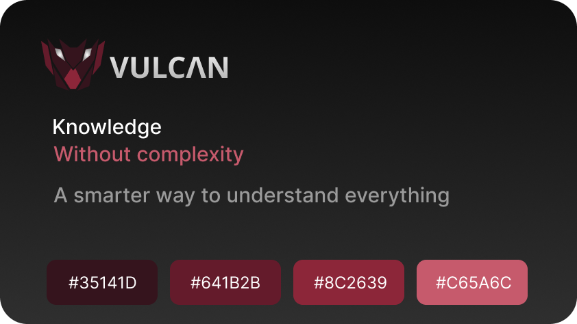
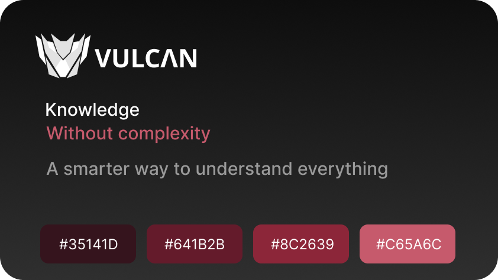
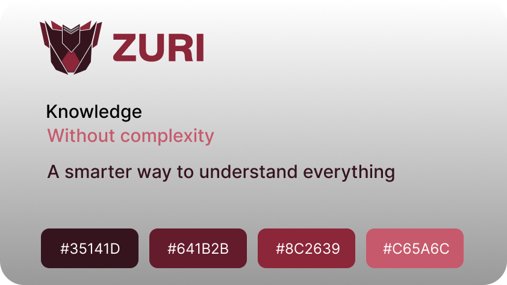

<h1>
 
 <span>Documentação Técnica - Zuri</span>
</h1>

[Português](README.pt-BR.md "Clique para Acessar a Documentação em Inglês")

## Sumário

- [1- Visualização Geral](#visualização-geral "Clique para Ver o Tópico da Visualização Geral")
- [2- Características](#características "Clique para Ver o Tópico das Características")
- [3- Identidade Visual](#identidade-visual "Clique para Ver o Tópico da Indentidade Visual")
  - [3.1- Cores](#1-cores "Clique para Ver o Subtópico das Cores")
  - [3.2- Logo](#2-logo "Clique para Ver o Subtópico da Logo")
- [4- Como Usar](#como-usar-o-plugin-do-zuri "Clique para Ver o Tópico do Tutorial de Como Usar")
- [5- Dependências](#dependências "Clique para Ver o Tópico das Dependências")
- [6- Ferramentas](#ferramentas "Clique para Ver o Tópico das Ferramentas")

## Visualização Geral

Widget React para IA Local e Produtividade

Zuri - Intelligence By Your Side é uma extensão para o Chrome construída com React + Manifest V3. É um Copiloto de Leitura e Contexto com IA — uma extensão React que permite selecionar qualquer texto ou trecho de código em uma página web e abrir um painel lateral com recursos de IA: resumo inteligente, explicação de trechos complexos, extração de conceitos-chave ou tradução explicativa.

Usa as APIs de IA nativas do próprio navegador para rodar offline e sem custos de API, ou permite que o usuário informe a própria chave de API. Este projeto exige excelente domínio de React — manipulação do DOM do navegador, injeção de content scripts, gerenciamento de estado no painel lateral e comunicação assíncrona de mensagens na extensão do Chrome. A Zuri transforma informações complexas em respostas claras e concisas.

É uma inteligência que aprende a entender o contexto e acompanha o usuário em suas atividades. A Zuri não foi desenvolvida para substituir o usuário. Ela foi desenvolvida para ampliar aquilo que ele é capaz de fazer.

Uma extensão só enxerga o que está dentro do navegador, então funciona em qualquer site.

## Características

Suas 05 características são:

- **Autônomo**: Analisa situações e propõe caminhos;
- **Confiável**: Prioriza respostas úteis e transparentes;
- **Inteligente**: Entende contextos;
- **Parcerio**: Trabalha ao lado do usuário em qualquer software, sem tentar tomar o seu lugar;
- **Determinado**: Uma identidade forte e comunicação objetiva.

## Identidade Visual

### 1. Cores

- Vermelho: `#35141D` `#641B2B` `#8C2639` `#C65A6C`;
- Branco: `#F5F5F5`;
- Preto: `#0E0E0E`;
- Cinza: `#999999`;

### 2. Logo


</br>

</br>


## Como Usar o Plugin do Zuri
 
1- Clono o repositório

```powershell
git clone https://github.com/kauanvinicius9/Zuri.git
```

2- Entre no projeto

```powershell
cd Zuri
```

3- Instale as dependências

```powershell
npm install
```

4- Atualize os arquivos

```powershell
npm run build
```

5- Execute o projeto

```powershell
npm run dev
```

6- Chrome

- Acesse as [Extensões do Chrome](chrome://extensions) e ative o **modo desenvolvedor**;
- Clique em **Carregar sem compactação**;
- Selecione a pasta `dist`, teste em qualquer página - selecione um texto, clique com o botão direito e escolha **Analizar com Zuri**. O painel lateral irá abrir. Clicando no link da extensão, também abre o painel.

Em seguida, o botão ativar na página inicial se comunica com a extensão (via postMessage para o content script) e define uma flag no chrome.storage. Com ela ligada, o content script exibe um popup flutuante próximo ao texto selecionado, com Resumir, Conceitos e Traduzir.

---

## Dependências

> tsconfig.app.json

```json
{
  "compilerOptions": {
    "tsBuildInfoFile": "./node_modules/.tmp/tsconfig.app.tsbuildinfo",
    "target": "es2023",
    "lib": ["ES2023", "DOM"],
    "module": "esnext",
    "types": ["vite/client", "chrome"],
    "allowArbitraryExtensions": true,
    "skipLibCheck": true,

    "moduleResolution": "bundler",
    "allowImportingTsExtensions": true,
    "verbatimModuleSyntax": true,
    "moduleDetection": "force",
    "noEmit": true,
    "jsx": "react-jsx",

    "noUnusedLocals": true,
    "noUnusedParameters": true,
    "erasableSyntaxOnly": true,
    "noFallthroughCasesInSwitch": true
  },
  "include": ["src"]
}
```

## Ferramentas

<div align="left">
    
    
    
    
    
    
</div>